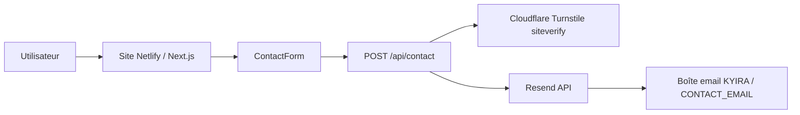
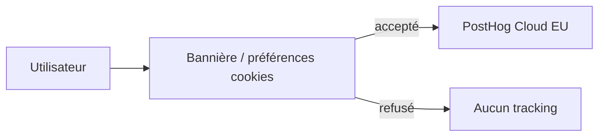

# 02 — Architecture technique

## Stack

**Confirmé par `package.json` et le code** :

| Couche | Technologie | Version (approx.) |
|---|---|---|
| Framework | Next.js (App Router) | 16.2.9 |
| UI | React | 19.2.4 |
| Langage | TypeScript | 5.x |
| Styles | Tailwind CSS | 4.x |
| Motion | `motion` | 12.x |
| Icônes | Hugeicons | — |
| Email | Resend SDK | 6.x |
| Analytics | `posthog-js` | 1.x |
| Antibot | Cloudflare Turnstile (script + siteverify) | — |
| Package manager | pnpm (`pnpm-lock.yaml`) | — |

Pas de base de données dans le dépôt actuel. Pas de Server Actions : le formulaire utilise un **Route Handler** `POST /api/contact`.

## Architecture Next.js

- **App Router** sous `app/`
- **Server Components par défaut** ; composants marqués `"use client"` lorsqu’il y a interactivité (formulaire, motion, analytics, menu, etc.)
- Runtime API contact : `nodejs` (`export const runtime = "nodejs"` dans `app/api/contact/route.ts`)
- Alias d’import `@/` → racine du projet (`tsconfig.json`)

### Client Components notables

Beaucoup de sections sont client pour Motion / tracking. Exemples :

- `components/sections/ContactForm.tsx`
- `components/analytics/PostHogProvider.tsx`
- `components/analytics/CookieConsentManager.tsx`
- `components/layout/Header.tsx` (+ variantes)
- sections hero / FAQ / etc.

Cela n’implique pas que toute la page soit CSR : le layout et les pages restent assemblés côté App Router ; le JS client est chargé pour ces îlots.

## Organisation des dossiers

```
app/                 Routes et layout
  api/contact/       Route Handler formulaire
  mentions-legales/
  politique-confidentialite/
components/
  analytics/         Consentement + PostHog UI
  layout/            Header, Footer
  sections/          Sections landing
  ui/                Primitives UI (Button, Input, TurnstileWidget…)
content/             Contenu éditorial (`landing.ts`)
lib/                 Logique (mail, turnstile, analytics, consent…)
types/               Types (`landing.ts`)
docs/                Documentation
public/              Assets statiques
```

### Rôle des dossiers clés

| Dossier / fichier | Rôle |
|---|---|
| `content/landing.ts` | Source unique des textes de la landing |
| `types/landing.ts` | Typage du contenu |
| `lib/contact-form.ts` | Normalisation + validation serveur des champs |
| `lib/mail.ts` | Envoi Resend |
| `lib/turnstile.ts` | Vérification token Turnstile |
| `lib/analytics.ts` | Événements, consentement analytics, section views |
| `lib/analytics-utm.ts` | Attribution first-touch |
| `lib/consent.ts` | Cookie de consentement first-party |
| `lib/site-variant.ts` | Switch hero/header `classic` \| `split` |

## Contenu et types

Le contenu n’est **pas** dans un CMS. Toute modification éditoriale passe par `content/landing.ts` (et éventuellement les pages légales sous `app/`).

## Routes publiques

| Route | Fichier | Rôle |
|---|---|---|
| `/` | `app/page.tsx` | Landing |
| `/mentions-legales` | `app/mentions-legales/page.tsx` | Mentions légales |
| `/politique-confidentialite` | `app/politique-confidentialite/page.tsx` | Confidentialité |

## Routes API

| Méthode | Chemin | Fichier |
|---|---|---|
| `POST` | `/api/contact` | `app/api/contact/route.ts` |

Aucune autre API dans le dépôt.

## Flux client / serveur

### Formulaire

1. Client : `ContactForm` valide les champs et possède un token Turnstile
2. Client : `POST /api/contact` (JSON)
3. Serveur : honeypot, validation, Turnstile siteverify, Resend
4. Client : toast succès / messages d’erreur ; événement PostHog si consentement

### Analytics

1. `PostHogProvider` initialise PostHog en **opt-out**
2. Bannière / préférences cookies (`CookieConsentManager`)
3. Si accepté : opt-in + Session Replay + `trackEvent` autorisé
4. Si refusé / retiré : stop replay, opt-out, reset, clear UTM locale

## Schémas Mermaid

### Contact et email



### Analytics (après consentement)



Ces diagrammes reflètent uniquement l’architecture vérifiée dans le code + le contexte d’hébergement Netlify. Le reverse proxy PostHog n’apparaît pas car **non actif**.
