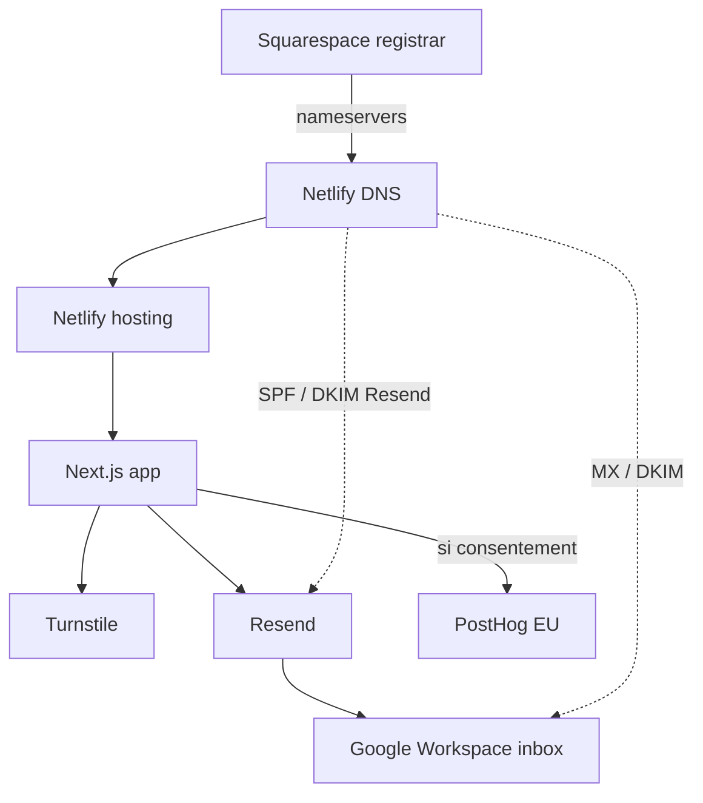

# 03 — Hébergement et infrastructure

## Vue d’ensemble des services

| Élément | Service | Rôle | Propriétaire du compte | Données stockées | Criticité |
|---|---|---|---|---|---|
| Application web | Netlify | Build, hébergement Next.js, HTTPS, env prod, DNS zone | **À confirmer** | Builds, logs, config site | Critique |
| Nom de domaine | Squarespace Domains | Registrar | Compte client KYIRA / Yannis | WHOIS / facturation domaine | Critique |
| Zone DNS | Netlify DNS | Enregistrements A/CNAME/MX/TXT… | Même compte Netlify (**À confirmer**) | Enregistrements DNS | Critique |
| Messagerie humaine | Google Workspace | Boîtes pro KYIRA | **À confirmer** | Emails professionnels | Critique |
| Envoi formulaire | Resend | SMTP transactionnel API | **À confirmer** | Logs d’envoi (dashboard Resend) | Haute |
| Antibot | Cloudflare Turnstile | Widget + vérification serveur | **À confirmer** (Cloudflare) | Tokens / métriques Turnstile | Haute |
| Analytics | PostHog Cloud EU | Events + Session Replay | **À confirmer** | Events / replays (UE) | Moyenne |
| Code source | GitHub | Dépôt `lazarefortune/kyira-energies` | **À confirmer** (accès équipe) | Historique git | Critique |

Sources : **contexte d’exploitation** pour Netlify / Squarespace / Workspace / Resend domaine vérifié ; **code** pour Resend / Turnstile / PostHog / Git remote observé.

## Rôles détaillés

### Netlify

- Héberge le site Next.js
- Exécute les builds et déploiements
- Stocke les variables d’environnement de production
- Gère le certificat HTTPS
- Gère actuellement la zone DNS du domaine (**confirmé par le contexte**)

Aucun fichier `netlify.toml` n’est présent dans le dépôt : la configuration build/domaine se fait principalement dans l’UI Netlify (**confirmé par le code** : absence de fichier).

### Squarespace

- Registrar du domaine `kyira-energies.com`
- Compte administré par Yannis (**confirmé par le contexte**)
- Les serveurs de noms pointent vers Netlify DNS

### Netlify DNS

- Zone DNS active
- Toute modification DNS (web, MX Workspace, Resend, futur CNAME PostHog) se fait ici

### Google Workspace

- Messagerie humaine KYIRA ENERGIES
- **Ne doit pas être remplacé par Resend**
- Les MX / DKIM Workspace doivent être préservés lors de changements DNS

### Resend

- Envoi des emails du formulaire uniquement
- Domaine `kyira-energies.com` vérifié (**contexte**)
- API key limitée à l’envoi ; réception Resend désactivée (**contexte**)
- Code : `lib/mail.ts`

### Cloudflare Turnstile

- Protection antibot du formulaire
- Secret serveur uniquement (`TURNSTILE_SECRET_KEY`)
- Code : `components/ui/TurnstileWidget.tsx`, `lib/turnstile.ts`

### PostHog

- Projet sur infrastructure européenne (**contexte + politique de confidentialité**)
- Tracking uniquement après consentement
- Host actuel via `NEXT_PUBLIC_POSTHOG_HOST` → endpoint EU **direct** (pas de reverse proxy actif)

## Où se trouve quoi

| Quoi | Où |
|---|---|
| Code source | GitHub (remote observé : `https://github.com/lazarefortune/kyira-energies.git`) |
| Builds / artefacts | Netlify |
| Variables d’environnement prod | Netlify → Site settings → Environment variables |
| Variables locales | `.env.local` (non versionné) |
| DNS | Netlify DNS |
| Registrar | Squarespace |
| Demandes de contact | Email `CONTACT_EMAIL` via Resend → boîte Workspace |
| Données analytics | PostHog Cloud EU |
| Consentement | Cookie navigateur `kyira_cookie_consent` (first-party) |
| Attribution UTM | `localStorage` clé `kyira_analytics_attribution` |

## Dépendances entre services

## Ce qui casse si un service devient indisponible

| Service | Impact |
|---|---|
| **Netlify** | Site inaccessible ; formulaires et pages hors ligne |
| **DNS (Netlify DNS)** | Résolution domaine cassée ; site, email et vérifications peuvent échouer selon les records touchés |
| **Resend** | Formulaire peut valider Turnstile puis échouer à l’envoi (`reason: send` / 502) |
| **Turnstile** | Soumission bloquée (`reason: turnstile` / 403) ou widget indisponible |
| **PostHog** | Pas d’impact conversion : le site et le formulaire restent fonctionnels ; plus de mesure |
| **Google Workspace** | KYIRA ne reçoit / ne lit plus les emails humains ; Resend peut quand même « réussir » l’envoi technique vers une boîte inaccessible |

## Note

Le README racine pointe désormais vers cette documentation et décrit Netlify comme plateforme de production. Détails de déploiement : [04-deployment.md](./04-deployment.md).
