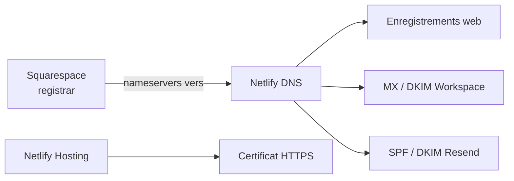

# 05 — Domaine, DNS et HTTPS

## Synthèse

| Sujet | État |
|---|---|
| Domaine principal | `https://kyira-energies.com` (**contexte**) |
| Variante www | Configurée avec redirection selon Netlify (**contexte**) |
| Registrar | Squarespace — compte Yannis (**contexte**) |
| Zone DNS | Netlify DNS (**contexte**) |
| TLS / HTTPS | Certificat géré par Netlify (**contexte**) |

> **Alerte — migration DNS**
>
> Toute migration ou reconstitution de zone DNS doit **d’abord sauvegarder puis recréer** :
>
> - les enregistrements **Google Workspace** (MX, DKIM, éventuels SPF/TXT)
> - les enregistrements **Resend** (SPF / DKIM / MX `send` selon la config Resend)
> - les enregistrements de **validation de domaine**
>
> Un oubli casse la messagerie humaine et/ou l’envoi du formulaire.

## Répartition des responsabilités



## Familles d’enregistrements

Ne pas documenter ici les valeurs secrètes ou DKIM complètes. Exemples **factices** uniquement.

### Web

- Enregistrements pointant vers Netlify (A / AAAA / CNAME selon la config Netlify du domaine)
- Redirection apex ↔ `www` gérée côté Netlify Domain management

### Email Google Workspace

- `MX` vers Google
- `TXT` SPF incluant Google
- Enregistrements DKIM Google (`google._domainkey…`) — **masquer** les clés dans toute doc / ticket

### Resend

- Enregistrements fournis par Resend pour vérifier `kyira-energies.com`
- Souvent : DKIM Resend, SPF, parfois MX `send` dédié à Resend
- La réception humaine reste Workspace ; Resend sert à l’**envoi** transactionnel

### Vérifications de domaine

- TXT de validation (Resend, Google, autres) — ne pas les supprimer « pour faire propre »

## DNSSEC

État DNSSEC : **À confirmer** dans Squarespace / Netlify. Ne pas activer/désactiver sans plan de rollback.

## Propagation DNS

Après une modification :

1. Noter l’heure du changement
2. Vérifier avec `dig` / outils DNS (plusieurs résolveurs)
3. Attendre la propagation (minutes à 48 h selon TTL)
4. Purger éventuellement le cache local / DNS provider

## Vérification des types d’enregistrements

Commandes d’exemple (remplacer le domaine) :

```bash
dig A kyira-energies.com +short
dig AAAA kyira-energies.com +short
dig CNAME www.kyira-energies.com +short
dig MX kyira-energies.com +short
dig TXT kyira-energies.com +short
dig CAA kyira-energies.com +short
```

Contrôler aussi les sous-domaines de validation (`_domainkey`, etc.) **sans publier** les valeurs complètes.

## Risques lors d’un changement de nameservers

- Coupure web
- Coupure email Workspace
- Échec d’authentification email (SPF/DKIM/DMARC) → spam
- Invalider temporairement le certificat ou la validation domaine
- Perte d’enregistrements non sauvegardés

**Procédure minimale** : export / capture d’écran de **tous** les records Netlify DNS → préparer la zone cible → basculer nameservers → vérifier web + email + Resend.

## HTTPS / SSL

- Certificat géré par Netlify
- Si certificat invalide : vérifier le domaine attaché au site, les DNS, les redirections, et forcer un renouvellement / redeploy côté Netlify
- Ne pas exposer de clés privées (aucune clé TLS dans le dépôt — `.pem` est gitignoré)

## Procédure de vérification DNS (checklist)

- [ ] Nameservers Squarespace = Netlify
- [ ] Site charge sur apex et www
- [ ] HTTPS valide
- [ ] MX Workspace présents et prioritaires attendues
- [ ] SPF ne contredit pas Workspace + Resend
- [ ] DKIM Workspace et Resend présents
- [ ] Envoi test formulaire reçu
- [ ] Email humain Workspace OK (envoi + réception)
