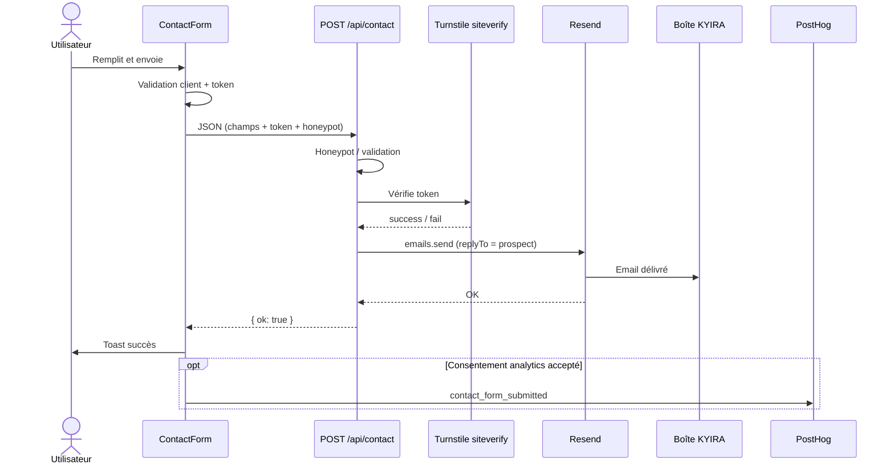

# 07 — Formulaire de contact

## Fichiers clés

| Fichier | Rôle |
|---|---|
| `components/sections/ContactForm.tsx` | UI, validation client, fetch, analytics |
| `components/ui/TurnstileWidget.tsx` | Widget Turnstile |
| `app/api/contact/route.ts` | Route Handler `POST` |
| `lib/contact-form.ts` | Normalisation + validation serveur |
| `lib/contact-destination.ts` | Résolution `CONTACT_EMAIL` |
| `lib/mail.ts` | Envoi Resend |
| `lib/turnstile.ts` | Vérification Cloudflare |
| `content/landing.ts` → `contact` | Labels, messages, champs |

## Champs

| Champ | Obligatoire | Limite | Notes |
|---|---|---|---|
| `name` | Oui | 100 | |
| `company` | Oui | 150 | |
| `email` | Oui | 254 | Pattern basique email |
| `phone` | Non | 40 | |
| `message` | Oui | 5000 | Textarea |
| `website` | — | — | **Honeypot** (doit rester vide) |
| `turnstileToken` | Oui (serveur) | — | Token Cloudflare |

## Validation client

Dans `ContactForm` :

- Champs requis + format email
- Token Turnstile requis **si** `NEXT_PUBLIC_TURNSTILE_SITE_KEY` est défini
- `noValidate` HTML : validation custom
- Messages depuis `landingContent.contact`

## Validation serveur

Dans `validateContactFields` puis la route :

1. JSON parseable
2. Honeypot `website` rempli → **succès silencieux** `{ ok: true }` (anti-bot)
3. Champs / longueurs / email
4. Présence du token Turnstile
5. `verifyTurnstileToken`
6. Config mail (`isMailConfigured` + destinataire)
7. `sendContactEmail`

## Codes de retour API

| Résultat | HTTP | `reason` |
|---|---|---|
| Succès / honeypot | 200 | — |
| Validation | 400 | `validation` |
| Turnstile | 403 | `turnstile` |
| Config manquante | 503 | `config` |
| Échec Resend | 502 | `send` |

## Resend / destinataire / replyTo

- Destinataire : `CONTACT_EMAIL`
- Expéditeur : `RESEND_FROM_EMAIL`
- `replyTo` : email du prospect (`lib/mail.ts`)
- Sujet : `Nouvelle demande depuis le site KYIRA ENERGIES`
- Corps texte (pas de HTML) avec nom, entreprise, email, téléphone, message, date Europe/Paris

## Événements PostHog liés

Émis **uniquement** si consentement accepté (`trackEvent`) :

| Événement | Quand |
|---|---|
| `contact_form_started` | Premier focus du formulaire |
| `contact_form_submit_attempted` | Soumission |
| `contact_form_validation_failed` | Échec validation client |
| `contact_form_submitted` | Succès API réel |
| `contact_form_failed` | Échec API / réseau |

Propriétés typiques : `form_location`, `submit_source`, `failure_reason` — **jamais** nom / email / téléphone / message.

## Données personnelles traitées

Via le formulaire → email KYIRA :

- Nom, entreprise, email, téléphone (optionnel), message

Ces données ne sont **pas** envoyées à PostHog (**confirmé par le code** + politique de confidentialité).

## Diagramme de séquence

## Sécurité

- Honeypot
- Turnstile serveur obligatoire
- Sanitisation basique des retours chariot dans les headers email
- Pas d’exposition du secret Turnstile / clé Resend
- Runtime Node pour l’API

## Scénarios d’erreur

| Symptôme UI | Cause probable |
|---|---|
| Message turnstile | Token manquant / invalide / secret absent |
| Message config | Variables Resend / CONTACT_EMAIL manquantes |
| Message send | Resend en erreur / domaine non vérifié |
| Succès sans email reçu | Mauvaise `CONTACT_EMAIL`, spam, Workspace down |

## Checklist de test

- [ ] Champs vides → erreurs client
- [ ] Email invalide → erreur
- [ ] Sans Turnstile → erreur
- [ ] Envoi OK → toast + email reçu + reply-to correct
- [ ] Honeypot rempli (devtools) → 200 sans email métier attendu
- [ ] Sans consentement → pas d’events PostHog
- [ ] Avec consentement → `contact_form_submitted` visible dans Live events
- [ ] Pas de PII dans les propriétés PostHog
